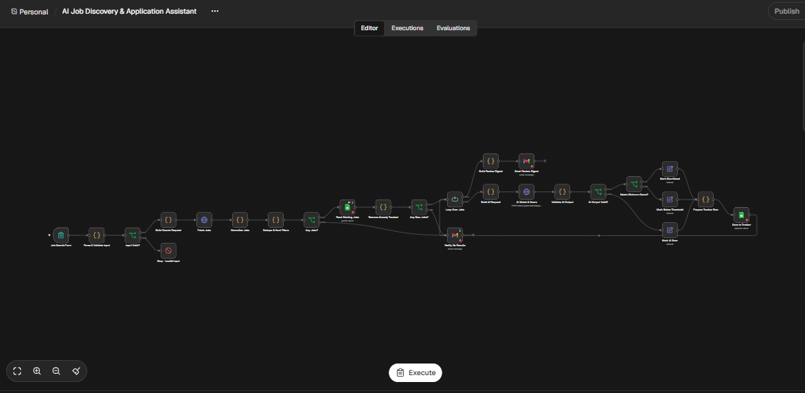

# 🔎 AI Job Discovery & Application Assistant

An AI-powered job discovery and matching automation system built with **n8n, Google Gemini, Remotive, Google Sheets, and Gmail**.

This project automates job discovery, evaluates opportunities against a predefined candidate profile, identifies relevant positions using AI-powered match scoring, tracks job applications, and delivers personalized job recommendations through email.

## 🚀 Project Overview

Finding relevant job opportunities can be a time-consuming process.

Candidates often spend hours searching job boards, reviewing job descriptions, comparing requirements with their skills, and maintaining spreadsheets to track opportunities.

The **AI Job Discovery & Application Assistant** streamlines this process through an automated workflow.

Users submit their preferred job title, minimum match score, and email address through an n8n form. The system retrieves available job listings, evaluates each opportunity using Google Gemini, filters results based on the selected score threshold, stores job information in Google Sheets, and sends an email summary of shortlisted opportunities.

The objective is to make job discovery more structured, efficient, and data-driven.

## ✨ Key Features

### 1. Job Search Form

Provides an n8n-powered form for collecting job search preferences.

Users provide:

- Job Title
- Minimum Match Score (0–100)
- Email Address

The workflow validates submitted information before proceeding.

### 2. Automated Job Discovery

- Retrieves job listings from Remotive.
- Searches based on the requested job title.
- Processes available job information.
- Extracts job titles, company names, locations, descriptions, and application URLs.
- Normalizes job records for further processing.

### 3. Duplicate Job Detection

The workflow checks previously tracked job URLs in Google Sheets.

- Reads existing job records.
- Compares newly discovered opportunities against saved records.
- Removes previously tracked jobs.
- Processes only new opportunities.

This helps prevent duplicate entries and repeated recommendations.

### 4. AI-Powered Job Matching

Google Gemini evaluates each job against a predefined candidate profile.

The matching process considers:

- Relevant technical skills.
- Work experience.
- Project experience.
- Job requirements.
- Entry-level suitability.
- Overall relevance to the candidate's background.

Each job receives:

- **Match Score:** A score between 0 and 100.
- **Reason:** A short explanation of the match.
- **Application Angle:** A recommendation identifying which candidate project or experience to highlight.

### 5. Configurable Match Threshold

Users can define their preferred minimum match score through the form.

For example:

| Minimum Score | Meaning |
|---|---|
| 50 | Broader opportunity discovery |
| 70 | Moderate relevance |
| 80 | Stronger relevance |
| 90 | Highly selective matching |

Only jobs meeting the selected threshold are marked as shortlisted.

### 6. Google Sheets Job Tracker

The workflow stores structured job information in Google Sheets.

The tracker includes:

| Field | Description |
|---|---|
| Date | Date the job was processed |
| Job Title | Position name |
| Company | Hiring organization |
| Location | Job location |
| Type | Work arrangement or job type |
| Salary | Available salary information |
| URL | Job application link |
| Score | AI-generated match score |
| Status | Shortlisted, below threshold, or AI error |
| Reason | AI-generated matching explanation |
| Apply Angle | Suggested experience or project to highlight |
| Published | Job publication information |

Both shortlisted and below-threshold records are tracked, along with AI processing errors.

### 7. Automated Email Notifications

Gmail integration delivers an email summary to the address submitted through the form.

The email includes:

- Number of shortlisted opportunities.
- Job titles and companies.
- Locations and work arrangements.
- AI-generated match scores.
- Reasons for matching.
- Suggested application angles.
- Direct job links.

If no new jobs are discovered, the workflow sends a notification informing the user.

### 8. AI Output Validation

The workflow validates the AI-generated response before applying the score threshold.

This helps identify invalid AI output and track processing errors instead of treating every response as a valid match.

## 🧰 Technology Stack

| Technology | Purpose |
|---|---|
| n8n | Workflow automation and orchestration |
| Google Gemini | AI-based job matching and scoring |
| Remotive API | Job listing discovery |
| Google Sheets | Job tracking and data storage |
| Gmail API | Job recommendation emails |
| JavaScript | Data validation, transformation, and processing |

## ⚙️ Workflow Architecture

The automation follows this process:

```text
Job Search Form
      ↓
Parse & Validate Input
      ↓
Input Valid?
      ↓
Build Search Request
      ↓
Fetch Jobs from Remotive
      ↓
Normalize Job Data
      ↓
Deduplicate & Apply Hard Filters
      ↓
Read Existing Jobs from Google Sheets
      ↓
Remove Already Tracked Jobs
      ↓
Any New Jobs?
      │
      ├── No → Send No Results Email
      │
      └── Yes
             ↓
        Loop Over Jobs
             ↓
        Build AI Request
             ↓
        Google Gemini
             ↓
        Validate AI Output
             ↓
        AI Output Valid?
             │
             ├── No → Mark AI Error
             │
             └── Yes
                    ↓
              Meets Minimum Score?
                    │
                    ├── Yes → Mark Shortlisted
                    │
                    └── No → Mark Below Threshold
                              ↓
                       Prepare Tracker Row
                              ↓
                       Save to Google Sheets
                              ↓
                       Process Next Job
                              ↓
                       Build Review Digest
                              ↓
                       Send Email Summary
```

## 🖼️ Workflow Preview

### Complete n8n Workflow



## 📂 Project Structure

```text
AI-Job-Discovery-Agent/
│
├── AI Job Discovery & Application Assistant.json
├── WF.PNG
└── README.md
```

## 🛠️ Installation & Setup

### Prerequisites

Before importing the workflow, prepare:

- An n8n Cloud or self-hosted instance.
- A Google Gemini API key.
- A Google account with Gmail access.
- A Google Sheets account.
- A Google Sheets spreadsheet with a worksheet named `Tracker`.

### 1. Clone the Repository

```bash
git clone https://github.com/mujtabamajidgit/AI-Job-Discovery-Agent.git
```

### 2. Import the Workflow

1. Open your n8n workspace.
2. Create a new workflow.
3. Open the workflow menu.
4. Select Import from File.
5. Choose `AI Job Discovery & Application Assistant.json`.

### 3. Configure Google Gemini

1. Generate a Google Gemini API key.
2. Open the `AI Match & Score` HTTP Request node.
3. Add your Gemini API key securely.
4. Verify that the selected Gemini model is available.
5. Test the AI response.

### 4. Configure Google Sheets

1. Create a Google spreadsheet.
2. Create a worksheet named `Tracker`.
3. Add the required columns described in the database section.
4. Connect your Google Sheets OAuth2 credentials.
5. Select your spreadsheet in the Google Sheets nodes.

### 5. Configure Gmail

1. Connect your Gmail account through OAuth2.
2. Configure the email nodes.
3. Verify that the submitted email address is used as the notification recipient.

### 6. Configure the Candidate Profile

The current workflow includes a predefined candidate profile inside the `Build AI Request` Code node.

To personalize the matching process:

1. Open `Build AI Request`.
2. Locate the `PROFILE` variable.
3. Replace the demonstration candidate information with your own skills, experience, projects, and career preferences.
4. Save the workflow.

### 7. Test the Workflow

Submit a sample job search:

- Job Title: AI Automation Intern
- Minimum Score: 70
- Your Email: your-email@example.com

Execute the workflow and verify:

- Job listings are retrieved.
- Existing jobs are excluded.
- Gemini evaluates each new job.
- Scores are validated.
- Jobs are classified according to the selected threshold.
- Results are stored in Google Sheets.
- An email digest is delivered.

## 📊 Example Use Cases

This automation can be adapted for:

- AI Automation Internships.
- Junior AI Engineer positions.
- Junior AI Agent Developer roles.
- n8n Automation Developer opportunities.
- Python Developer internships.
- Remote Software Engineering positions.
- Entry-level technical roles.

## 🔒 Security & Configuration

- Never publish API keys or private credentials.
- Use your own Google Gemini API key.
- Connect your own Google accounts.
- Keep candidate information accurate and up to date.
- Avoid publishing private email addresses or personal information.
- Verify job listings and application links before applying.

## ⚠️ Current Limitations

This version focuses on job discovery and matching, not fully automated job applications.

- Job listings are sourced from Remotive.
- The candidate profile is predefined in the workflow.
- AI match scores are estimates, not official ATS scores.
- Job availability depends on the external job source.
- The workflow does not automatically submit job applications.
- It does not generate downloadable tailored resumes or cover letters.
- It does not independently verify whether an employer is still accepting applications.
- Duplicate detection is based on previously tracked job records.

## 🔮 Future Enhancements

Potential improvements include:

- Multiple job-board integrations.
- User-specific candidate profiles.
- Resume PDF/DOCX upload and parsing.
- Advanced semantic job matching.
- Automated resume tailoring.
- AI-generated cover letters.
- Application status tracking.
- Job alerts and scheduled searches.
- Interactive job discovery dashboard.
- Interview preparation assistant.
- Recruiter outreach message generation.

## 🎯 Business Applications

The system can be adapted into:

- Personal AI job discovery assistants.
- University career placement platforms.
- Recruitment support systems.
- Career consultancy automation.
- AI-powered candidate opportunity matching.

## 👨‍💻 Author

**Mujtaba Majid Baig**

Software Engineering Student | AI Automation & AI Agent Developer

I build AI-powered automation systems that help individuals and businesses streamline repetitive processes, improve operational efficiency, and make better use of artificial intelligence.

- GitHub: [@mujtabamajidgit](https://github.com/mujtabamajidgit)
- Project Repository: [AI Job Discovery Agent](https://github.com/mujtabamajidgit/AI-Job-Discovery-Agent)

---

⭐ If you find this project useful, consider giving the repository a star!

**Built with n8n, Google Gemini, Remotive, Google Sheets, and Gmail.**
